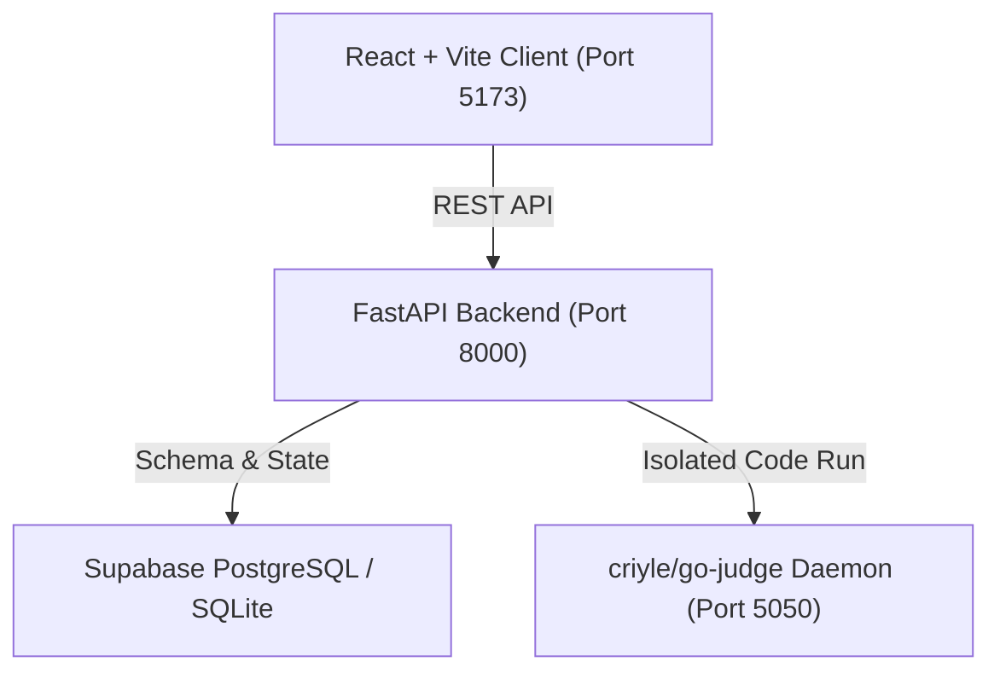

# Debug Dojo (DI-01)

> An AI-powered coding coach that helps learners find bugs without handing them the answer.
> Built for the **Decentralized Intelligence Track (DI-01)**.

---

## Quickstart (One Command)

Per **Deliverable 1**, start all services with a single command:

### macOS / Linux
```bash
./start.sh
```

### Windows
```cmd
start.bat
```

This launches:
1. **`go-judge` Sandbox Engine**: `http://localhost:5050`
2. **FastAPI Backend**: `http://localhost:8000` (docs at `http://localhost:8000/docs`)
3. **Debug Dojo Web Client**: `http://localhost:5173`

---

## Architecture Overview



* **Frontend**: React 19 + Vite with dark-mode aesthetic, zero UI layout modifications, responsive execution tabs, progressive 4-tier hint ladder, and mastery analytics.
* **Backend**: FastAPI with async route handlers, CORS configuration, schema validation, and rule-based + LLM evaluation pipelines.
* **Sandbox Runner**: **`criyle/go-judge`** microservice implementing native OS isolation:
  - **Windows**: Windows **Job Objects** (`JOB_OBJECT_LIMIT_PROCESS_TIME`, `JOB_OBJECT_LIMIT_JOB_MEMORY`, `JOB_OBJECT_LIMIT_KILL_ON_JOB_CLOSE`, `procLimit=1`).
  - **Linux / macOS**: `cgroups` + namespaces with strict CPU, wall-clock, memory (64MB), and output truncation (64KB).
  - **Resilient Fallback**: If `go-judge` is stopped, automatically falls back to an isolated subprocess execution runner with wall-clock timeouts.

---

## Required Judge Endpoints (DI-01 Specification)

### 1. `POST /api/submit`
Executes learner code against visible and hidden test cases.
* **Request**:
  ```json
  {
    "learner_id": "rohan",
    "challenge_id": "last-k-total",
    "code": "def last_k_total(marks, k):\n    ..."
  }
  ```
* **Response**:
  ```json
  {
    "submission_id": "sub_a151a1dc5605dfc1",
    "learner_id": "rohan",
    "challenge_id": "last-k-total",
    "visible": [
      { "test": 1, "call": "last_k_total([3, 8, 2, 5], 2)", "expected": "7", "got": "7", "outcome": "passed" }
    ],
    "hidden": [
      { "test": 4, "outcome": "passed" }
    ],
    "mistake_tags": ["unhandled_short_input"],
    "explanation": "All 3 visible tests pass, but 3 of the 5 hidden tests fail...",
    "limit": null
  }
  ```
  * **Four Strict Outcomes**: `passed`, `wrong_output`, `runtime_error`, `timeout`.
  * **Hidden Test Secrecy**: Hidden test inputs, expected values, outputs, and stack traces are **never** returned to the client.

### 2. `POST /api/hint`
Returns progressive hints that guide without revealing code.
* **Request**:
  ```json
  { "submission_id": "sub_a151a1dc5605dfc1" }
  ```
* **Response**:
  ```json
  {
    "hint_index": 1,
    "hint": "Your three examples never ask for more marks than the list holds. What should last_k_total return when k is bigger than the list?",
    "remaining": 3
  }
  ```

### 3. `GET /api/learner/{learner_id}`
Returns learner analytics, recurring mistake categories, concept mastery scores, and next targeted mission.
* **Response**:
  ```json
  {
    "learner_id": "rohan",
    "recurring_mistakes": ["unhandled_short_input"],
    "mastery": { "Lists": 85.0, "Slicing": 70.0 },
    "next_challenge": {
      "id": "pair-sum",
      "title": "Pair Sum",
      "reason": "Targeted practice for unhandled_short_input on list boundaries."
    }
  }
  ```

---

## Red-Team Containment & Hostile Program Defense

The sandbox contains all hostile attack vectors tested by the judges:
1. **Infinite Loops (`while True: pass`)**: Terminated by CPU/clock limit; classified as `timeout`.
2. **Memory Exhaustion (`[0] * 10**8`)**: Hard-killed by memory ceiling (64MB); classified as `runtime_error` with `limit="memory"`.
3. **Fork Bombs (`os.fork()`)**: Process limit (`procLimit: 1`) prevents spawning child processes.
4. **Stdout / Disk Floods (`print("A" * 100000)`)**: Truncated at 64KB ceiling; classified as `runtime_error` with `limit="output"`.
5. **Harness Tampering & Introspection**: Code runs in a fresh, isolated subprocess; runner internals and hidden test cases cannot be modified or inspected.

---

## Verification & Automated Tests

Run the full verification test suite:

```bash
# Run unit tests and API route verification
cd server
PYTHONPATH=. .venv/bin/pytest

# Run red-team hostile containment suite
PYTHONPATH=. .venv/bin/pytest tests/test_redteam.py

# Verify frontend build & linting
cd ../client
npm run lint
npm run build
```

---

## Deliverables Checklist (DI-01)
- [x] **1. Code Repository & README**: Single-command startup (`start.sh` / `start.bat`).
- [x] **2. Restricted Execution**: Hardened `go-judge` sandbox + isolated runner fallback.
- [x] **3. Per-Test Outcomes**: Exactly 4 outcomes (`passed`, `wrong_output`, `runtime_error`, `timeout`) with resource limit reporting.
- [x] **4. Hidden-Test Secrecy**: Server-side containment with zero data leakage.
- [x] **5. Plain-Language Explanations**: Constructive feedback without revealing answers.
- [x] **6. Progressive Hints**: 4-tier progressive hint ladders.
- [x] **7. Mistake Taxonomy**: 5 core categories (`docs/mistake_taxonomy.md`).
- [x] **8. Concept Mastery & Progression**: Dynamic mastery updating and weakness-targeted mission dispatch.
