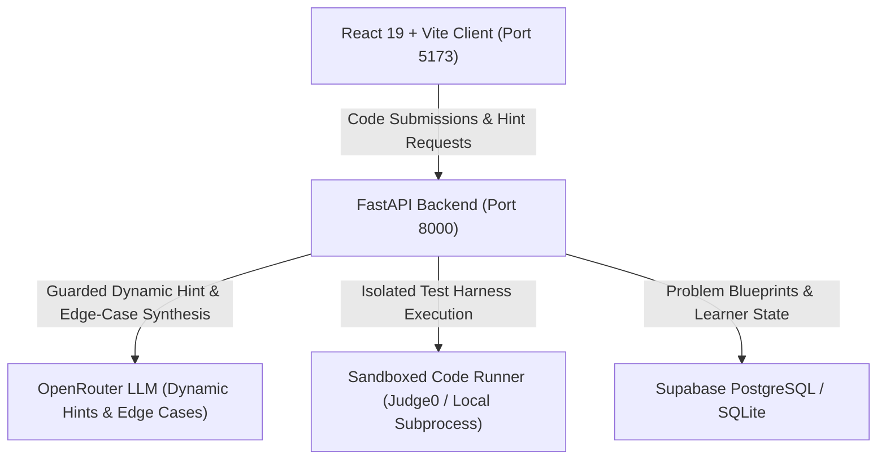

# CursedCode

> An AI-powered competitive programming & DSA workbench with dynamic guarded hints, adversarial edge-case synthesis, and zero-leakage sandboxed code execution.

---

## Architecture Overview



- **Frontend**: React 19 + Vite with a responsive dark cyberpunk UI, dual editor (Monaco IDE & Cyber Textarea), floating animated hint bot avatar, interactive problem catalog, and mastery dashboards.
- **Backend**: FastAPI with asynchronous request handling, schema validation, prompt engineering with AST safety verification, and progressive hint guardrails.
- **AI Intelligence**: OpenRouter LLM integration for calibrated 4-level progressive hints and automated synthesis of canonical + adversarial edge-case test suites.
- **Code Execution**: Dual-tier execution engine supporting cloud-based Judge0 and a hardened local sandboxed subprocess runner (`bwrap` namespace isolation or POSIX `setrlimit` resource controls).
- **Persistence**: Supabase PostgreSQL repository with automatic fallback for challenge storage, submission history, and concept mastery tracking.

---

## Key Features

### 1. Dynamic 4-Tier Progressive Hint Ladder
Rather than giving away code answers immediately, CursedCode provides a calibrated progressive hint ladder:
- **Level 1 (Concept Nudge)**: Pinpoints algorithmic blind spots and logic oversights without spoiling code.
- **Level 2 (Edge-Case Clarification)**: Highlights boundary conditions (empty inputs, single elements, zero, negatives).
- **Level 3 (Structural Guide)**: Provides high-level pseudocode structure and invariant guidance.
- **Level 4 (Surgical Code Fix)**: Pinpoints the exact faulty line and delivers a concrete replacement block.

### 2. Animated Hint Bot & 1-Click Code Patching
- An interactive bouncing robot avatar accompanies learners throughout the workbench.
- Dynamic speech bubble positioned to the left of the editor so it never obscures user code.
- At Level 4 hints, a **`[ ⚡ Apply Bot Fix ]`** button allows learners to automatically apply the suggested fix into the editor with one click.

### 3. Dual Editor Experience
- **Monaco Editor**: Full-featured VS Code-grade editing with syntax highlighting, autocomplete, indentation guides, and line numbers.
- **Cyber Textarea**: Ultra-fast, lightweight fallback editor for low-spec devices or distraction-free coding.

### 4. AI Edge-Case & Test-Case Synthesis
- Ingestion engine powered by OpenRouter that generates comprehensive test harnesses:
  - **3 Visible Tests**: Canonical and standard sample cases for initial debugging.
  - **5 to 7 Hidden Edge Cases**: Adversarial test cases specifically targeting empty lists, singletons, boundary bounds, negative values, duplicates, and order invariants.
- Automatic AST parsing validation ensures all generated test calls are syntactically valid Python expressions.

### 5. Curated Sheet Importer
- Built-in catalog support for popular competitive programming and interview sheets:
  - **Striver's A2Z DSA Sheet**: Set Matrix Zeroes, Pascal's Triangle, Maximum Subarray (Kadane's), Sort Colors (012), Best Time to Buy and Sell Stock, Rotate Matrix 90°, Merge Overlapping Intervals, Longest Consecutive Sequence.
  - **CP-31 Sheet (Ladder 800-1000)**: Watermelon, Way Too Long Words, Bit++, Domino Piling, Beautiful Matrix, Elephant.
- **Custom Problem Importer**: Paste any problem statement, signature, and constraints to generate edge cases and seed the judge.
- One-click batch import and single-problem import directly into the challenge database.

### 6. Zero-Leakage Confidentiality & Sandboxing
- Hidden test cases are strictly confidential: inputs, expected values, actual outputs, and stack traces are **never** returned to the client.
- Exactly 4 deterministic execution outcomes: `passed`, `wrong_output`, `runtime_error`, `timeout`.
- Detects input mutation side-effects (`mutates_input`) when functions mutate argument arrays in-place.
- Hardened sandbox defends against infinite loops, fork bombs, memory exhaustion, and disk floods.

### 7. Concept Mastery & Analytics
- Tracks recurring mistake categories: `unhandled_short_input`, `unhandled_empty_input`, `off_by_one`, `incorrect_base_case`, `mutation_side_effect`.
- Dynamic topic mastery bars (Arrays, Two Pointers, Hashing, Dynamic Programming, Strings, Math).
- Weakness-targeted next challenge recommendations.

---

## Quickstart

### Prerequisites
- **Python 3.10+**
- **Node.js 18+** and **npm**

### 1. Environment Configuration

Create a `.env` file in the `server` directory (or root):

```env
APP_ENV=development
APP_NAME=CursedCode API
API_PREFIX=/api
FRONTEND_ORIGIN=http://localhost:5173

# OpenRouter (required for dynamic hints and AI edge-case generation)
OPENROUTER_API_KEY=your_openrouter_api_key
OPENROUTER_MODEL=anthropic/claude-3.5-sonnet

# Supabase (optional; falls back to in-memory/mock storage)
SUPABASE_URL=your_supabase_url
SUPABASE_SERVICE_ROLE_KEY=your_service_role_key

# Code Runner (optional; falls back to local sandboxed subprocess runner)
RUNNER_BASE_URL=https://judge0-ce.p.rapidapi.com
RUNNER_API_KEY=
RUNNER_TIMEOUT_SECONDS=15
RUNNER_MEMORY_LIMIT_MB=64

# LangSmith (optional tracing)
LANGSMITH_TRACING=false
LANGSMITH_API_KEY=
LANGSMITH_PROJECT=cursedcode
```

### 2. Start Services

#### Single-Command Startup:
```bash
# macOS / Linux
./start.sh

# Windows
start.bat
```

#### Manual Startup:

**Backend (FastAPI)**:
```bash
cd server
python -m venv .venv
source .venv/bin/activate  # On Windows: .venv\Scripts\activate
pip install -r requirements.txt
PYTHONPATH=. uvicorn app.main:app --host 0.0.0.0 --port 8000 --reload
```

**Frontend (React + Vite)**:
```bash
cd client
npm install
npm run dev
```

- **Frontend Application**: `http://localhost:5173`
- **Backend API**: `http://localhost:8000`
- **Interactive Swagger Docs**: `http://localhost:8000/docs`

---

## API Reference

### Code Execution & Submissions
- `POST /api/submit`: Submits learner code against visible and hidden test suites.
  ```json
  {
    "learner_id": "zeroeight",
    "challenge_id": "set-matrix-zeroes",
    "code": "def set_matrix_zeroes(matrix):\n    ..."
  }
  ```
  Returns submission ID, per-test outcomes (`passed`, `wrong_output`, `runtime_error`, `timeout`), mistake tags, and explanation without leaking hidden test data.

### Hint Generation
- `POST /api/hint`: Retrieves the next progressive hint for a submission.
  ```json
  {
    "submission_id": "sub_a151a1dc5605dfc1"
  }
  ```
  Returns `hint_index`, `level`, `hint` text, and optional `patch` (target line, target snippet, replacement code) at level 4.

### Challenges & Catalog
- `GET /api/challenges?learner_id=zeroeight`: Lists available challenges with difficulty, category, tags, and user completion status.
- `GET /api/challenges/{slug}`: Retrieves challenge details and visible test cases (hidden test contents remain server-side).

### Sheet Importer
- `GET /api/importer/sheets`: Returns curated DSA sheets (Striver's A2Z, CP-31) and their problem blueprints.
- `POST /api/importer/generate-tests`: Uses OpenRouter to dynamically synthesize visible and adversarial hidden edge cases.
- `POST /api/importer/import-problem`: Persists a challenge with its generated test cases and hints to the database.
- `POST /api/importer/batch-import`: Batch imports an entire sheet into the platform.

### Learner Analytics
- `GET /api/learner/{learner_id}`: Returns concept mastery scores, recurring mistake tags, and weakness-targeted next problem recommendations.

---

## Red-Team Containment & Hostile Program Defense

CursedCode enforces rigorous security constraints to safely execute untrusted learner code:
1. **Infinite Loops (`while True: pass`)**: Terminated by CPU/wall-clock timeouts; classified as `timeout`.
2. **Memory Exhaustion (`[0] * 10**8`)**: Hard-killed by memory ceiling (64MB); classified as `runtime_error` with `limit="memory"`.
3. **Fork Bombs (`os.fork()`)**: Process limit (`RLIMIT_NPROC`) prevents spawning child processes.
4. **Stdout / Disk Floods (`print("A" * 100000)`)**: Truncated at 64KB ceiling; classified as `runtime_error` with `limit="output"`.
5. **Harness Tampering & Introspection**: User code runs in an isolated subprocess; runner internals and hidden test cases cannot be accessed or modified.

---

## Automated Verification

Run the automated test suite across backend routes, dynamic hint pipelines, and hostile code containment:

```bash
# Run API routes, dynamic hints, and submission tests
PYTHONPATH=server server/.venv/bin/pytest server/tests/test_api.py

# Run hostile code red-team containment suite
PYTHONPATH=server server/.venv/bin/pytest server/tests/test_redteam.py

# Run frontend build check
cd client && npm run build
```
